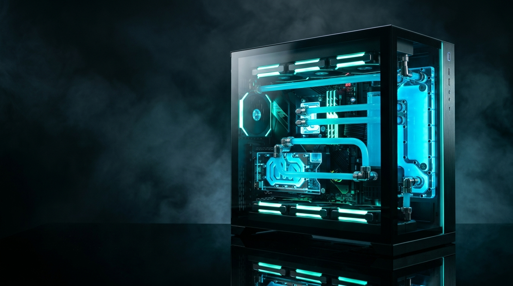

# Aqua PC Solutions — Interactive 3D PC Building Bay & Launch Portal

A photorealistic, standalone 3D WebGL PC configurator, assembly workshop, and cinematic launch portal for **Aqua PC Solutions** (`https://aquapcsolutions.yyth.workers.dev/`).

## Highlights

- **Real-Time 3D PC Building Bay (`scene3d.js` + `js/pc-model.js`)**:
  - Full-detail ATX custom build with dual-chamber tempered glass showcase chassis.
  - Interactive component swapping: Intel Core i9-14900K / AMD Ryzen 9 7950X3D, NVIDIA RTX 4090 / 4080S / 4070S / RX 7800 XT, 360mm / 240mm AIO Liquid Coolers or Dual-Tower Air Cooler, DDR5 ARGB memory kits, and 1000W modular PSU.
  - Procedural CNC brushed gunmetal GPU backplate with exposed core retention X-clamp, SMD capacitor arrays, and flow-through fin exhausts.
  - 8-Step physical fly-in assembly wizard (`1. Case` through `8. Power ON`).
  - Exploded 3D schematic view, openable tempered glass, and animated aerodynamic streamlines.

- **Direct 3D Raycasting & In-Viewport Quick-Swap HUD**:
  - Hover over any 3D component inside the PC to trigger real-time raycast highlight cages and spec cards.
  - Click directly on 3D parts to open the instant in-viewport swap drawer.
  - 1-Click Complete Rig Presets: **4K Hydro Flagship**, **Esports 540Hz Pro**, **Glacier White Showcase**, and **Creator & AI Studio**.

- **Full-Page 3D Spatial World & Perspective Parallax**:
  - Three.js 3D background world with architectural perspective grids, floating wireframe silicon polyhedra, and depth particles that react dynamically to page scrolling and mouse motion.
  - 3D perspective tilt (`transform-style: preserve-3d`) on showcase cards.

- **Dual 3D Bench Telemetry Monitors & Live Benchmarks**:
  - Rear 3D lab monitor running live Bench Telemetry OS with real-time oscillating sine waves.
  - Secondary 3D display showing Cyberpunk 2077 (4K RT Overdrive) and CS2 / Valorant FPS estimates with dynamic power load telemetry.

- **Cinematic HD Video Showreel & Studio Bento Gallery**:
  - 8 local 720p hardware bench clips (`pc-internals`, `cpu-board`, `microchip`, `circuit-board`, `tech-workshop`, etc.).
  - Photorealistic macro photography of ESD lab GPU installs, custom liquid cooling loops, and board-level micro-soldering.

- **Hyperspace Warp Redirection to Official Storefront**:
  - Direct deep-links to `/`, `/shop`, `/services`, `/pricing`, `/about`, and `/contact` on `https://aquapcsolutions.yyth.workers.dev/`.
  - Smart auto-launch countdown with auto-pause during 3D customizer interaction.
  - Web Audio API procedural sound synthesizer (chimes, clicks, power humming).

## Zero-Build Static Deployment

This portal is completely self-contained with no build steps or external dependencies required:
- Open [`index.html`](file:///e:/Aqua%20soft%20Site/redirect-portal/index.html) in any modern browser.
- Host anywhere: **GitHub Pages**, **Cloudflare Pages**, **Vercel**, or **Netlify**.

## Author & Lab

- **Founder & Lead Hardware Engineer**: S.L.K Thinul Hansana
- **Location**: Embilipitiya, Sri Lanka
- **Hotline**: +94 78 819 4535
- **Official Storefront**: [https://aquapcsolutions.yyth.workers.dev/](https://aquapcsolutions.yyth.workers.dev/)
